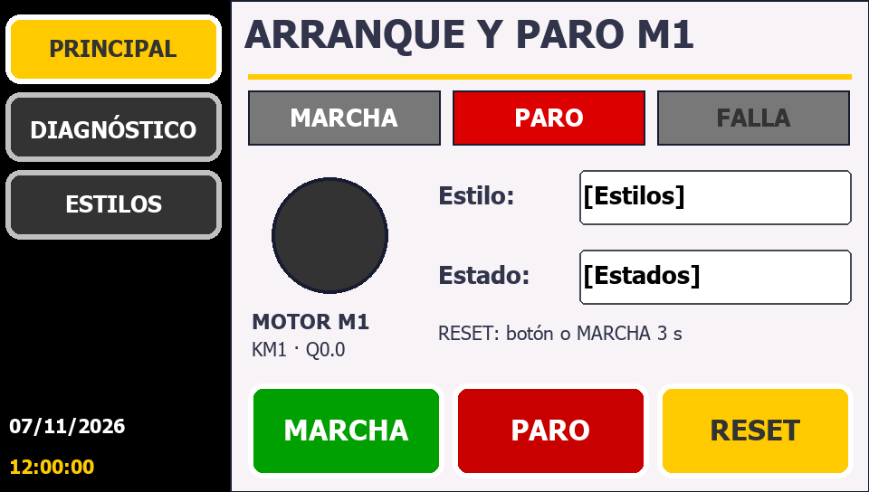
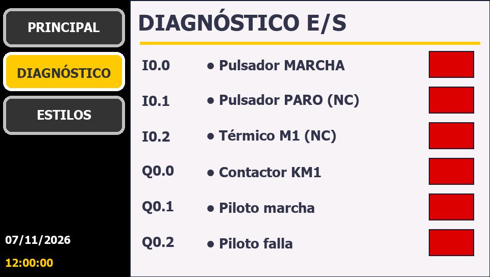
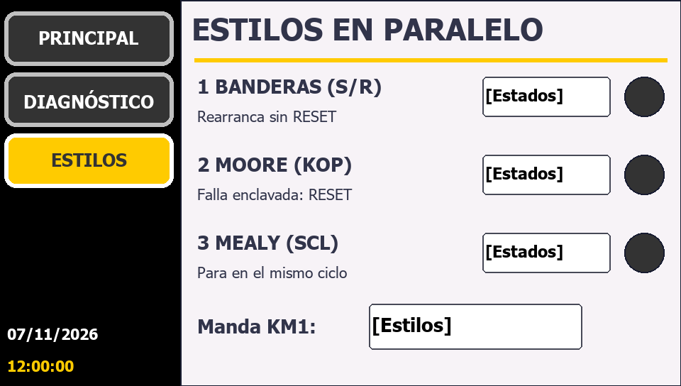

# TIA_ArranqueParo

Arranque y paro de un motor generado de forma automática en **TIA Portal V17** con **Claude Code + TIA Openness**, sin costo adicional.

> **Versión actual: [v2 — PLC + HMI KTP400 + 3 estilos (Banderas / Moore / Mealy)](v2/README.md)**, generada con el MCP [TIA_MCP_V17](https://github.com/alfresonico666/TIA_MCP_V17).
>
> | Principal | Diagnóstico | Estilos |
> |---|---|---|
> |  |  |  |

Lo que sigue documenta la **v1**: solo PLC, generada con los scripts de la raíz (`tia/`, `programas/`).

## Lógica

```
 Red 1 (FB_ArranqueParo)
 |--+--[ #Marcha ]--+--[ #Paro_NC ]--[ #Termico_NC ]--( #Motor )--|
    +--[ #Motor  ]--+
```

| Tag | Dirección | Dispositivo |
|---|---|---|
| Marcha | %I0.0 | Pulsador verde, NA |
| Paro_NC | %I0.1 | Pulsador rojo, **NC** |
| Termico_NC | %I0.2 | Relé térmico 95-96, **NC** |
| Motor | %Q0.0 | Bobina del contactor KM1 |

El OB1 (Main) llama a `FB_ArranqueParo` con su DB de instancia `DB_ArranqueParo`. El paro y el térmico se cablean NC por seguridad: si se corta un cable, el motor se detiene.

## Requisitos (una sola vez)
1. Tener tu usuario de Windows en el grupo **Siemens TIA Openness**. Ya está agregado.
2. **Cerrar sesión de Windows y volver a entrar.** Sin este paso, Windows todavía no aplica el permiso.
3. Instalar las dependencias: `.venv\Scripts\pip install -r requirements.txt`

## Cómo ejecutar
```powershell
cd C:\Users\LEGION\Proyectos\TIA_ArranqueParo
.venv\Scripts\python tests\test_ladder.py        # 1) valida el XML sin abrir TIA
.venv\Scripts\python crear_arranque_paro.py      # 2) crea, importa y compila en TIA
```
- Si TIA ya está abierto **sin proyecto**, el script se conecta a esa ventana. Si TIA está cerrado, lo abre él mismo.
- La primera vez, TIA muestra un aviso de **acceso Openness**: responde **"Sí a todo"**.
- El proyecto se crea en `tia_proyecto\ArranqueParo\ArranqueParo.ap17`.
- Si la compilación muestra errores, cópialos a Claude para que los corrija.

## Prueba en PLCSIM V17
1. En TIA, selecciona `PLC_1` y pulsa **Iniciar simulación**. Se abre PLCSIM.
2. Pulsa **Cargar en dispositivo**, acepta y pon la CPU en **RUN**.
3. En el árbol del proyecto, abre `PLC_1 > Tablas de observación` y agrega una tabla nueva con `Marcha`, `Paro_NC`, `Termico_NC` y `Motor`. Activa **Observar todo** (icono de gafas).
4. Para cambiar entradas usa *Forzar* (F) en la tabla, o la tabla SIM de PLCSIM en vista de proyecto.

| # | Acción | Resultado esperado |
|---|---|---|
| 0 | Reposo: `Paro_NC=1`, `Termico_NC=1`, `Marcha=0` | `Motor=0` |
| 1 | `Marcha=1` y luego `Marcha=0` | `Motor=1` y **se mantiene** (retención) |
| 2 | `Paro_NC=0` (pulsar paro) | `Motor=0` |
| 3 | `Paro_NC=0` y `Marcha=1` a la vez | `Motor=0` (paro dominante) |
| 4 | Con el motor en marcha: `Termico_NC=0` | `Motor=0` |
| 5 | `Termico_NC=0` y `Marcha=1` | `Motor=0` (no arranca con falla) |

## Versiones
| Versión | Contenido |
|---|---|
| v1_ClaudeTIA_ArranqueParo | Arranque y paro con retención en KOP generado por XML + Openness (scripts propios) |
| v2_ArranqueParoHMIEstilos | PLC + HMI KTP400 generados con el MCP: tablas de tags estándar, DB_HMI, mando pulsadores+HMI, 3 estilos (Banderas KOP, Moore KOP, Mealy SCL) y 3 pantallas. Ver [v2/README.md](v2/README.md) |

Para saber cómo trabajamos (plantillas, referencias, copias, versiones), consulta [docs/COMO_TRABAJAMOS.md](docs/COMO_TRABAJAMOS.md).
