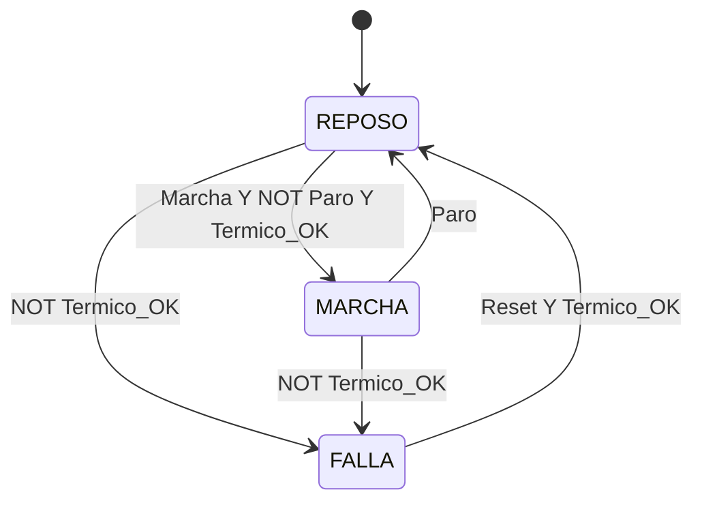
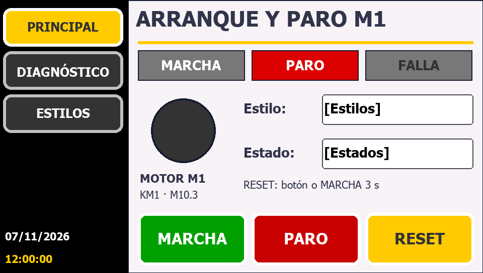
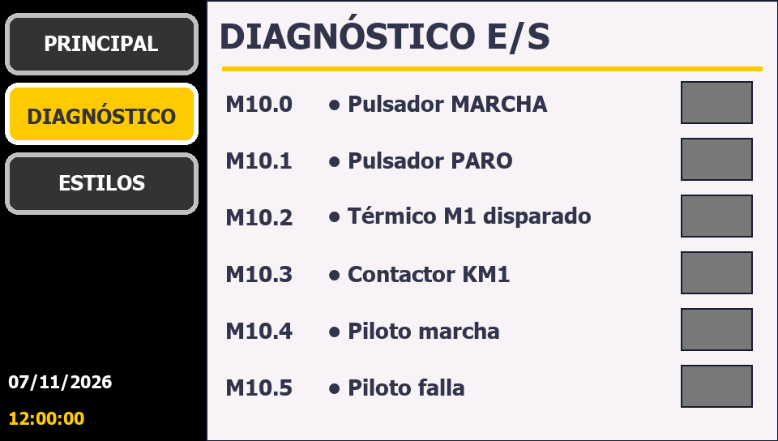
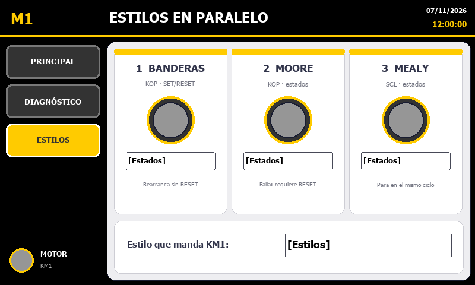

# Arranque y paro v2: PLC + HMI KTP400 + 3 estilos de programación

Proyecto **generado automáticamente** con el MCP [TIA_MCP_V17](https://github.com/alfresonico666/TIA_MCP_V17) (v3).
Toda la especificación está en [`especificacion.py`](especificacion.py) y el generador en [`generar_v2.py`](generar_v2.py).

| | |
|---|---|
| PLC | S7-1214C AC/DC/RLY `6ES7 214-1BG40-0XB0` V4.5, IP 192.168.0.1 |
| HMI | KTP400 Basic PN `6AV2 123-2DB03-0AX0`, imagen V17, IP 192.168.0.2 |
| Red | PN/IE_1 · conexión HMI `HMI_Connection_1` (se crea a mano, ver abajo) |
| Idiomas | es-MX (edición) + en-US |
| Resultado | PLC **0 errores** · HMI **0 errores** (tags HMI enlazados al PLC por `HMI_Connection_1`) |

## Estructura del programa

El OB1 hace de **"director"**: una red por función que llama a un bloque, con la misma estructura del
proyecto de referencia probado en producción.

```
OB1 Main (KOP)
 ├─ MANDO                FB_Mando_Motor   (KOP)  pulsadores + botones HMI, reset = RESET o MARCHA 3 s
 ├─ ESTILO 1 BANDERAS    FB_Motor_Banderas(KOP)  SET/RESET con banderas
 ├─ ESTILO 2 MOORE       FB_Motor_Moore   (KOP)  máquina de estados: comparadores + MOVE
 ├─ ESTILO 3 MEALY       FB_Motor_Mealy   (SCL)  máquina de estados: CASE
 ├─ SALIDAS              KM1 / HL_Marcha / HL_Falla = las del estilo elegido en la HMI
 └─ HMI                  DB_HMI: motor en marcha, falla, estado del estilo elegido
```
Los tres estilos corren **a la vez** con las mismas entradas: en la pantalla *Estilos* se ve cómo reacciona
cada uno, y el selector decide cuál maneja el contactor real.

### Tablas de tags (estándar del MCP)
| Tabla | Tag | Dirección | Descripción |
|---|---|---|---|
| Pulsadores_y_selectores | `PB_Marcha` | %I0.0 | Pulsador MARCHA (NA) |
| Pulsadores_y_selectores | `PB_Paro_NC` | %I0.1 | Pulsador PARO (**NC**, 1 = no pulsado) |
| Motores | `MOT1_Termico_NC` | %I0.2 | Relé térmico 95-96 (**NC**, 1 = sin falla) |
| Motores | `KM1_Motor` | %Q0.0 | Contactor KM1 |
| Pilotos | `HL_Marcha` | %Q0.1 | Piloto verde |
| Pilotos | `HL_Falla` | %Q0.2 | Piloto rojo |

`DB_HMI`: Cmd_Marcha, Cmd_Paro, Cmd_Reset (botones momentáneos), Sel_Estilo (1/2/3), Estado, Motor_En_Marcha,
Falla_Termico, Pantalla. La HMI **nunca escribe salidas físicas**: solo comandos en el DB, y el PLC decide.

## Los 3 estilos

| | Banderas (S/R) | Moore | Mealy |
|---|---|---|---|
| Lenguaje | KOP | KOP | SCL |
| Las salidas dependen de… | las banderas | **solo del estado** | del estado **y** de las entradas |
| Falla del térmico | se para; al recuperarse puede volver a arrancar **sin RESET** | queda en FALLA **hasta RESET** | queda en FALLA hasta RESET |
| Al pulsar PARO | cae al ciclo siguiente | cae al ciclo siguiente (cambio de estado) | cae **en el mismo ciclo** |
| Ideal para | lógica simple, retenciones | secuencias de máquina, diagnóstico claro | respuestas rápidas con pocos estados |

### Máquina de estados Moore (`FB_Motor_Moore`)

Salidas: MARCHA (10) → Motor, Piloto_Marcha · FALLA (90) → Piloto_Falla.

### Máquina de estados Mealy (`FB_Motor_Mealy`)
Los mismos estados y transiciones. Diferencia: en MARCHA, **Motor = NOT Paro Y Termico_OK**. Es decir, la salida
mira las entradas y no espera al cambio de estado.

## HMI (KTP400, 480×272)
Aspecto: fondo negro, botón de navegación activo amarillo, inactivos gris oscuro, panel claro y Tahoma.
Estructura: columna de navegación a la izquierda, contenido a la derecha y fecha/hora abajo a la izquierda.

| Principal | Diagnóstico E/S | Estilos |
|---|---|---|
|  |  |  |

*Vistas previas generadas por el MCP (`tia_hmi vista_previa`). En TIA/runtime los campos muestran los valores reales.*

## Pasos para dejarlo funcionando

### 1. Paso manual, una sola vez (≈1 minuto)
Openness V17 **no puede** crear la conexión HMI integrada ni elegir la pantalla inicial.
1. Abre `tia_proyecto\ArranqueParo_v2\ArranqueParo_v2.ap17` en TIA Portal.
2. **Dispositivos y redes** → vista de redes → botón **Conexiones** → elige **Conexión HMI** → arrastra del puerto
   PROFINET de **HMI_1** al de **PLC_1**. Se crea `HMI_Connection_1`.
3. **HMI_1 → Configuración de runtime → General → Pantalla inicial = `Principal`**.
4. Guarda (Ctrl+S).

> ⚠️ **No** la crees desde *HMI_1 → Conexiones*: así se genera una conexión **no integrada** (`Connection_1`),
> que solo admite direcciones absolutas. Tiene que ser la de la **vista de redes** (`HMI_Connection_1`).

### 2. Enlazar la HMI con el PLC (automático)
**Con el proyecto abierto en TIA** (en vivo; no lo cierra):
```powershell
cd C:\Users\LEGION\Proyectos\TIA_ArranqueParo
C:\Users\LEGION\Proyectos\TIA_MCP_V17\.venv\Scripts\python v2\enlazar_en_vivo.py
```
Hace lo siguiente:
1. Verifica que la conexión integrada exista en el proyecto guardado. Si no está, se detiene sin tocar nada.
2. Enlaza los 20 tags HMI al PLC.
3. Compila el PLC y la HMI.
4. Exporta y guarda.

Con el proyecto **cerrado**, usa `generar_v2.py --enlazar-plc`. En ambos casos el resultado es: PLC y HMI con **0 errores**.
> ⚠️ Usa `--enlazar-plc` **solo** después del paso 1: si la conexión no existe, TIA se cierra al importar los tags.

### 3. Probar con PLCSIM + simulación de HMI
1. Selecciona `PLC_1` → **Iniciar simulación** → **Cargar** → **RUN**.
2. Selecciona `HMI_1` → **Iniciar simulación**.
3. En una tabla de observación pon `PB_Paro_NC = 1` y `MOT1_Termico_NC = 1`. Es el reposo real: los contactos NC están cerrados.

| # | Acción (HMI o tabla) | Banderas | Moore | Mealy |
|---|---|---|---|---|
| 1 | MARCHA | Motor ON, estado MARCHA | Motor ON, MARCHA (10) | Motor ON, MARCHA (10) |
| 2 | PARO | Motor OFF | Motor OFF → REPOSO | Motor OFF en el mismo ciclo → REPOSO |
| 3 | MARCHA y luego `MOT1_Termico_NC = 0` | OFF, piloto falla | FALLA (90) | FALLA (90) |
| 4 | `MOT1_Termico_NC = 1` y MARCHA | **vuelve a arrancar** | sigue en FALLA | sigue en FALLA |
| 5 | RESET (o MARCHA 3 s) y luego MARCHA | — | REPOSO → MARCHA | REPOSO → MARCHA |
| 6 | Cambiar el selector de estilo en marcha | KM1 lo maneja el nuevo estilo | | |

## Archivos
| Archivo | Contenido |
|---|---|
| `especificacion.py` | Tags, DB_HMI, FB, máquinas de estados, OB1, pantallas HMI |
| `generar_v2.py` | Orquesta el MCP: crea o abre el proyecto, programa, compila, exporta y archiva |
| `enlazar_en_vivo.py` | Sobre el TIA abierto: verifica la conexión, enlaza tags HMI al PLC, compila y guarda |
| `exportado/` | Lo que TIA devolvió: XML + texto de bloques, tablas de tags y pantallas (para Git) |
| `docs/*.png` | Vistas previas de las pantallas |
| `../entregas/v2_ArranqueParoHMIEstilos.zap17` | Proyecto archivado (adjunto en el GitHub Release, no en git) |
